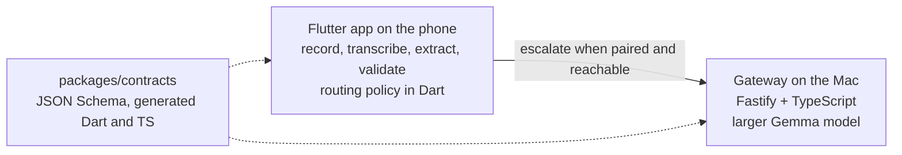

# Fieldnote Edge

Fieldnote Edge records meetings and customer visits on an Android phone, transcribes them offline, and extracts a structured summary: participants, topics, decisions, and action items with owners and deadlines. Summaries come from Gemma 4 E2B running on the phone. When a job is too large for the phone, or the phone's output fails validation, the app sends it to a larger Gemma model on the user's Mac over the local network. The app stays useful when the Mac is off.

The project sets itself apart with reproducible measurements of phone-only, Mac-only and hybrid execution, a durable job state machine, and authenticated pairing between the phone and the Mac on the LAN.

**Status.** The Milestone 0 measurement tooling and the Milestone 1 product code are built and tested in CI, but nothing has been run on the target devices yet. The models and size limits are the spike's candidates until the go/no-go table in [docs/spike/RUNBOOK.md](docs/spike/RUNBOOK.md) is filled in. No latency, memory or accuracy numbers are published, because none have been measured on the target devices. See [PROGRESS.md](PROGRESS.md).

## Platforms and devices

- Android and macOS. The test devices are a OnePlus 11R (Android 16) and a MacBook Air M4 ([docs/devices.md](docs/devices.md)).
- **iOS is out of scope**, because the project has no iOS device to test on.
- ASR languages: English, Tamil, Malayalam and Hindi, plus Tamil-English, Malayalam-English and Hindi-English code-switching.

## Architecture



The routing decision runs on the phone and is deterministic ([ADR 0002](docs/decisions/0002-routing-in-the-app.md)). The gateway never decides where a job runs. The full diagram, with what is built and what is planned, is in [docs/architecture.md](docs/architecture.md).

## Repository layout

| Path | Contents |
| --- | --- |
| `apps/mobile` | Flutter app for Android and macOS: recording, on-device transcription and summaries, validation, routing, pairing. |
| `apps/spike` | Milestone 0 measurement app: on-device LLM and ASR latency and memory. |
| `services/gateway` | Fastify + TypeScript gateway on the Mac: pinned TLS, pairing, an idempotent job API, an OpenAI-compatible model backend, mDNS. |
| `packages/contracts` | JSON Schema contracts and the Dart and TypeScript types generated from them. |
| `benchmarks/evaluation` | WER and CER evaluator, run summarizer. |
| `benchmarks/harness` | Mac-arm runner and phone, Mac and hybrid combiner. |
| `packages/gateway_client` | Dart client the phone uses for discovery, pinned TLS, pairing and jobs. |
| `benchmarks/datasets` | Dataset sources and licenses. No audio is committed. |
| `benchmarks/results` | Results template and schemas. |
| `docs` | Architecture, security, failure handling, devices, spike findings, runbook, ADRs. |

## Run each part

These commands were run in a Linux container with Node.js 22.23, pnpm 10.28, Flutter 3.47.9 (Dart 3.13.7) and Python 3.13. CI runs the same checks on Ubuntu with Python 3.12.

### Install

```bash
pnpm install
```

### Gateway

```bash
pnpm --filter @fieldnote/gateway build
PORT=8787 node services/gateway/dist/src/server.js
```

In a second terminal, from the repository root (the certificate is self-signed, so pin its public key):

```bash
PIN=$(openssl x509 -in data/tls/gateway-cert.pem -pubkey -noout | openssl pkey -pubin -outform der | openssl dgst -sha256 -binary | base64)
curl -sS -k --pinnedpubkey "sha256//$PIN" https://127.0.0.1:8787/health
```

The response is `{"status":"ok","service":"fieldnote-gateway","version":"0.0.0"}`.

Checks:

```bash
pnpm --filter @fieldnote/gateway lint
pnpm --filter @fieldnote/gateway format:check
pnpm --filter @fieldnote/gateway typecheck
pnpm --filter @fieldnote/gateway test
```

### Contracts

```bash
pnpm --filter @fieldnote/contracts check
pnpm --filter @fieldnote/contracts typecheck
pnpm --filter @fieldnote/contracts test
```

```bash
cd packages/contracts/dart
dart pub get
dart analyze
dart test
```

### Gateway client

```bash
pnpm --filter @fieldnote/gateway build
cd packages/gateway_client
dart pub get
dart test
```

The integration tests start the built gateway as a child process.

### Mobile app

```bash
cd apps/mobile
flutter pub get
flutter analyze
flutter test
flutter build apk --release --target-platform android-arm64
```

### Spike app

```bash
cd apps/spike
flutter pub get
flutter analyze
flutter test
```

Device runs follow [docs/spike/RUNBOOK.md](docs/spike/RUNBOOK.md).

`flutter build apk --release --target-platform android-arm64` succeeded for both apps in the development container (`minSdkVersion` 30, LiteRT libraries for `arm64-v8a`). Neither app has been run on a device, and no macOS build has been made, because the container has no phone and no Mac.

### Evaluation

```bash
cd benchmarks/evaluation
python3 -m unittest discover -s tests -t .
python3 -m asr_eval --references examples/references.jsonl --hypotheses examples/hypotheses.jsonl --output report.json
```

The example files only show the input format. They are not measurements.

### Harness

```bash
pnpm --filter @fieldnote/harness test
```

## Roadmap

Nothing below is built unless it is marked **built**.

### Milestone 0: feasibility spike

- **built.** Package, model and license findings with sources: [docs/spike/findings.md](docs/spike/findings.md). Some dataset licenses are still unverified.
- **built.** Spike app that records time to first token, decode tokens per second, end-to-end latency and memory to JSON.
- **built.** WER and CER evaluator that keeps Indic vowel signs.
- **built.** Results template, results schemas, run summarizer, and output validator.
- **built.** Runbook and proposed decision gates: [ADR 0001](docs/decisions/0001-spike-decision-gates.md).
- not built: the measurements themselves. The user runs them on the devices with the runbook.
- not built: the go/no-go decision.

### Milestone 1: product (built in parallel with the device measurements)

- **built.** Durable job state machine and crash-safe job store on the phone ([ADR 0007](docs/decisions/0007-job-store-and-routing-rules.md)).
- **built.** Deterministic routing policy in Dart. Size limits are unset until measured.
- **built.** Recording, Whisper transcription in 30-second windows, Gemma 4 E2B summaries, schema validation, and escalation to the Mac ([ADR 0012](docs/decisions/0012-mobile-pipeline.md)). Not run on a device.
- **built.** Gateway job API with idempotent submits and SQLite storage ([ADR 0008](docs/decisions/0008-gateway-job-api.md)).
- **built.** Gateway inference through any OpenAI-compatible model server, and mDNS advertising ([ADR 0011](docs/decisions/0011-mac-inference-backend-and-mdns.md)). The Mac model is not measured.
- **built.** Pairing codes, device credentials, 15-minute session tokens and revocation ([ADR 0009](docs/decisions/0009-pairing-and-sessions.md)).
- **built.** TLS 1.3 with a pinned self-signed certificate, and pairing proofs bound to it ([ADR 0010](docs/decisions/0010-tls-and-pinned-pairing.md)).
- **built.** Dart gateway client with discovery, pinning, sessions and jobs, tested against the real gateway in CI.
- **built.** Phone-only, Mac-only and hybrid evaluation harness ([benchmarks/harness](benchmarks/harness)). Not run on real devices or a real model server.
- not built: transcription on the Mac. The gateway takes summary jobs only.
- not done: choosing the final models and size limits, which waits for the go/no-go table.

## License

[MIT](LICENSE)
