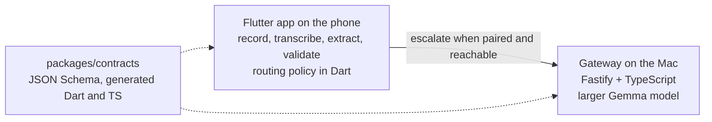

# Fieldnote Edge

Fieldnote Edge will record meetings and customer visits on an Android phone, transcribe them offline, and extract a structured summary: participants, topics, decisions, and action items with owners and deadlines. Summaries come from Gemma 4 E2B running on the phone. When a job is too large for the phone, or the phone's output fails validation, the app will send it to a larger Gemma model on the user's Mac over the local network. The app has to stay useful when the Mac is off.

The project sets itself apart with reproducible measurements of phone-only, Mac-only and hybrid execution, a durable job state machine, and authenticated pairing between the phone and the Mac on the LAN.

**Status: Milestone 0 (feasibility spike).** The repository contains measurement tooling and a project scaffold. The product itself is not built yet. No latency, memory or accuracy numbers are published yet, because none have been measured on the target devices. See [PROGRESS.md](PROGRESS.md).

## Platforms and devices

- Android and macOS. The test devices are a OnePlus 11R (Android 16) and a MacBook Air M4 ([docs/devices.md](docs/devices.md)).
- **iOS is out of scope**, because the project has no iOS device to test on.
- ASR languages: English, Tamil, Malayalam and Hindi, plus Tamil-English, Malayalam-English and Hindi-English code-switching.

## Architecture



The routing decision runs on the phone and is deterministic ([ADR 0002](docs/decisions/0002-routing-in-the-app.md)). The gateway never decides where a job runs. The full diagram, with what is built and what is planned, is in [docs/architecture.md](docs/architecture.md).

## Repository layout

| Path | Contents |
| --- | --- |
| `apps/mobile` | Flutter app for Android and macOS. It has one placeholder screen. |
| `apps/spike` | Milestone 0 measurement app: on-device LLM and ASR latency and memory. |
| `services/gateway` | Fastify + TypeScript gateway: `GET /health` and an idempotent job API with no model behind it yet. |
| `packages/contracts` | JSON Schema contracts and the Dart and TypeScript types generated from them. |
| `benchmarks/evaluation` | WER and CER evaluator, run summarizer. |
| `benchmarks/datasets` | Dataset sources and licenses. No audio is committed. |
| `benchmarks/results` | Results template and schemas. |
| `docs` | Architecture, security, failure handling, devices, spike findings, runbook, ADRs. |

## Run each part

These commands were run in a Linux container with Node.js 22.23, pnpm 10.28, Flutter 3.47.9 (Dart 3.13.7) and Python 3.13. CI runs the same checks on Ubuntu with Python 3.12.

### Install

```bash
pnpm install
```

### Gateway

```bash
pnpm --filter @fieldnote/gateway build
PORT=8787 node services/gateway/dist/src/server.js
```

In a second terminal:

```bash
curl -sS http://127.0.0.1:8787/health
```

The response is `{"status":"ok","service":"fieldnote-gateway","version":"0.0.0"}`.

Checks:

```bash
pnpm --filter @fieldnote/gateway lint
pnpm --filter @fieldnote/gateway format:check
pnpm --filter @fieldnote/gateway typecheck
pnpm --filter @fieldnote/gateway test
```

### Contracts

```bash
pnpm --filter @fieldnote/contracts check
pnpm --filter @fieldnote/contracts typecheck
pnpm --filter @fieldnote/contracts test
```

```bash
cd packages/contracts/dart
dart pub get
dart analyze
dart test
```

### Mobile app

```bash
cd apps/mobile
flutter pub get
flutter analyze
flutter test
```

### Spike app

```bash
cd apps/spike
flutter pub get
flutter analyze
flutter test
```

Device runs follow [docs/spike/RUNBOOK.md](docs/spike/RUNBOOK.md).

`flutter build apk --release --target-platform android-arm64` succeeded for `apps/spike` in the development container (59.5 MB, `minSdkVersion` 30, LiteRT libraries for `arm64-v8a`). Neither app has been run on a device, and no macOS build has been made, because the container has no phone and no Mac.

### Evaluation

```bash
cd benchmarks/evaluation
python3 -m unittest discover -s tests -t .
python3 -m asr_eval --references examples/references.jsonl --hypotheses examples/hypotheses.jsonl --output report.json
```

The example files only show the input format. They are not measurements.

## Roadmap

Nothing below is built unless it is marked **built**.

### Milestone 0: feasibility spike

- **built.** Package, model and license findings with sources: [docs/spike/findings.md](docs/spike/findings.md). Some dataset licenses are still unverified.
- **built.** Spike app that records time to first token, decode tokens per second, end-to-end latency and memory to JSON.
- **built.** WER and CER evaluator that keeps Indic vowel signs.
- **built.** Results template, results schemas, run summarizer, and output validator.
- **built.** Runbook and proposed decision gates: [ADR 0001](docs/decisions/0001-spike-decision-gates.md).
- not built: the measurements themselves. The user runs them on the devices with the runbook.
- not built: the go/no-go decision.

### Milestone 1: product (started in parallel with the device measurements)

- **built.** Durable job state machine and job store on the phone ([ADR 0007](docs/decisions/0007-job-store-and-routing-rules.md)). Not wired into the app yet.
- **built.** Deterministic routing policy in Dart. Size limits are unset until measured.
- **built.** Gateway job API with idempotent submits and SQLite storage ([ADR 0008](docs/decisions/0008-gateway-job-api.md)). No model runs on it yet.
- not built: recording
- not built: on-device transcription and summary extraction
- not built: gateway inference with the larger Gemma model
- not built: mDNS discovery, pairing, session credentials, TLS with certificate pinning, and revocation ([docs/security.md](docs/security.md))
- not built: phone-only, Mac-only and hybrid evaluation harness

## License

[MIT](LICENSE)
