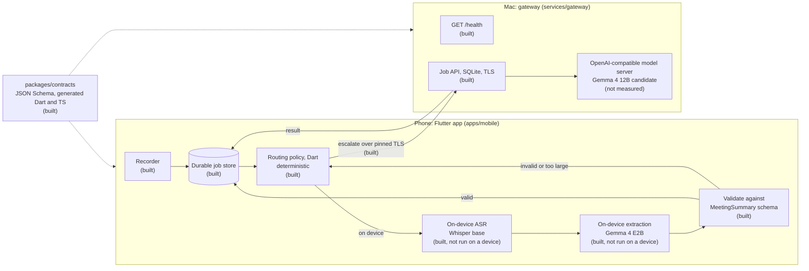

# Architecture

Fieldnote records a meeting or customer visit on the phone, transcribes it, and extracts a structured summary (participants, topics, decisions, action items with owners and deadlines). The phone does all of this by itself. When a job is too large for the phone, or the phone's output fails validation, the app can send the job to a larger model on the user's Mac over the local network. The app has to stay useful when the Mac is off.

Status: only the boxes marked **built** exist. Everything else is planned. [PROGRESS.md](../PROGRESS.md) tracks status.

## Components

### Phone app (`apps/mobile`)

The phone app is built with Flutter for Android and macOS. iOS is out of scope, because the project has no iOS device. It records, transcribes and summarizes on the device, validates summaries, routes jobs, and pairs with the Mac ([ADR 0012](decisions/0012-mobile-pipeline.md)). It has not been run on a device yet.

### Routing policy (planned, in the app)

The routing policy (`apps/mobile/lib/src/routing/routing_policy.dart`) is a Dart function of the task type, the input size, the validation result, whether the Mac is paired and reachable, and the user's settings. It is deterministic. Historical accuracy is not an input. The gateway never makes routing decisions. See [ADR 0002](decisions/0002-routing-in-the-app.md).

### Gateway (`services/gateway`)

The gateway is a Fastify and TypeScript service on the Mac. It serves `GET /health` and an idempotent job API backed by SQLite ([ADR 0008](decisions/0008-gateway-job-api.md)) over TLS 1.3 with a pinned certificate ([ADR 0010](decisions/0010-tls-and-pinned-pairing.md)). It runs summaries through any local OpenAI-compatible model server and advertises itself over mDNS ([ADR 0011](decisions/0011-mac-inference-backend-and-mdns.md)). It validates its environment at startup and writes structured JSON logs with a correlation ID per request. It listens only on loopback until pairing exists ([ADR 0006](decisions/0006-gateway-binds-loopback-until-pairing.md)).

### Contracts (`packages/contracts`)

The contracts package holds JSON Schema files, with TypeScript and Dart types that quicktype generates from them. CI fails if the generated files are stale. See [ADR 0003](decisions/0003-contracts-generator.md).

### Spike and evaluation (`apps/spike`, `benchmarks/`)

These are the Milestone 0 measurement tools. The spike app measures on-device LLM and ASR latency and memory. `benchmarks/evaluation` computes WER and CER and summarizes run files. Their results decide which models and languages go into Milestone 1 ([ADR 0001](decisions/0001-spike-decision-gates.md)).

## Execution modes that the evaluation compares

| Mode | ASR | Extraction | Needs the Mac |
| --- | --- | --- | --- |
| Phone only | phone | phone | no |
| Mac only | Mac | Mac | yes |
| Hybrid | phone | phone, escalating to the Mac when validation fails or the input is too large | only for escalated jobs |

Only phone-only measurements are possible in Milestone 0, because the gateway has no inference yet.
