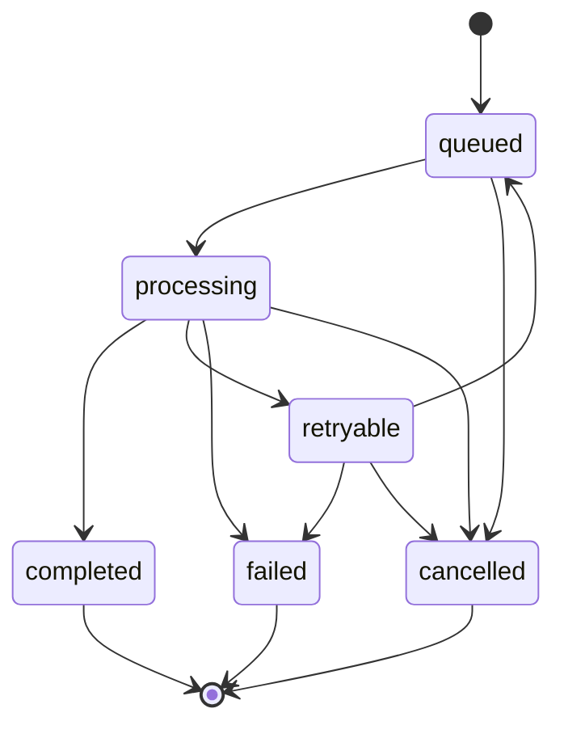

# Failure handling

This page lists the mechanisms for jobs that fail or are interrupted, and the status of each. The phone's job store and the gateway's job API exist, but the app does not run jobs yet.

## Durable job state machine

Every job (transcription or summary extraction) has one state, stored on the phone so it survives the app being killed or the phone restarting.

| State | Meaning | Status |
| --- | --- | --- |
| `queued` | Waiting to run. | implemented in the phone job model |
| `processing` | Running on the phone or on the Mac. | implemented in the phone job model |
| `completed` | Finished, with a validated result. | implemented in the phone job model |
| `retryable` | Failed for a reason that may go away, such as the Mac being unreachable or the app being killed mid-run. It will run again. | implemented in the phone job model |
| `failed` | Failed for a reason a retry will not fix, such as unreadable audio, or the retry limit being reached. | implemented in the phone job model |
| `cancelled` | Stopped by the user. | implemented in the phone job model |

## Planned mechanisms

| Mechanism | Purpose | Status |
| --- | --- | --- |
| Persist state before side effects | A job moves to `processing` in storage before work starts, so a crash leaves a job that can be found and moved to `retryable`. | implemented in the phone job store and the gateway |
| Recover on startup | On launch, every job left in `processing` moves to `retryable` on the phone, or back to `queued` on the gateway. | implemented in the phone job store and the gateway |
| Idempotent job submission to the Mac | Each job has a stable ID. Sending it twice gives one result, not two. | implemented in the gateway ([ADR 0008](decisions/0008-gateway-job-api.md)) |
| Bounded retries with backoff | A `retryable` job retries a limited number of times, waiting longer each time, and then becomes `failed`. | implemented in the phone job model |
| Phone-only fallback | If the Mac is unreachable, a job that can run on the phone runs there instead of waiting. | implemented in the routing policy, not wired into the app |
| Output validation | Every result is validated against the `MeetingSummary` schema before the job is `completed`. On the phone, an invalid result is a reason to escalate. | implemented in the gateway; not yet on the phone |
| Long audio windowing | Audio is split into windows the ASR model accepts, because `flutter_edge_ai_speech` silently truncates longer audio. The spike already does this. | implemented in `apps/spike` only |
