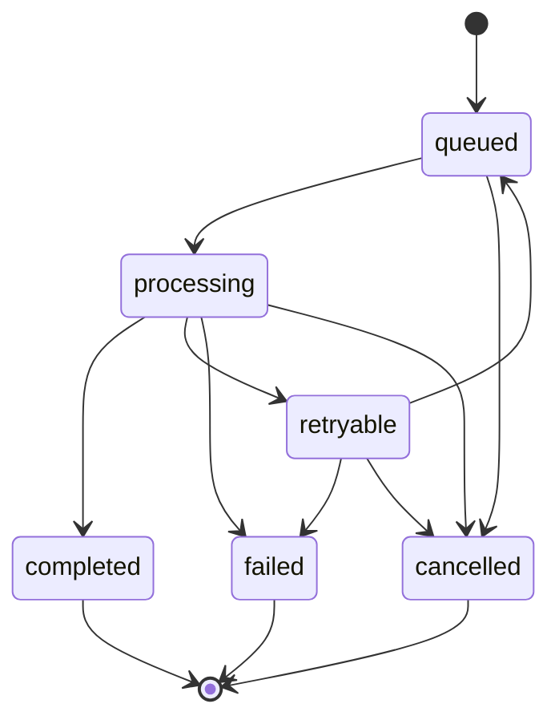

# Failure handling

This page lists the planned mechanisms for jobs that fail or are interrupted. **None of them is implemented yet.** Milestone 0 has no job processing.

## Durable job state machine

Every job (transcription or summary extraction) has one state, stored on the phone so it survives the app being killed or the phone restarting.

| State | Meaning | Status |
| --- | --- | --- |
| `queued` | Waiting to run. | not yet implemented |
| `processing` | Running on the phone or on the Mac. | not yet implemented |
| `completed` | Finished, with a validated result. | not yet implemented |
| `retryable` | Failed for a reason that may go away, such as the Mac being unreachable or the app being killed mid-run. It will run again. | not yet implemented |
| `failed` | Failed for a reason a retry will not fix, such as unreadable audio, or the retry limit being reached. | not yet implemented |
| `cancelled` | Stopped by the user. | not yet implemented |

## Planned mechanisms

| Mechanism | Purpose | Status |
| --- | --- | --- |
| Persist state before side effects | A job moves to `processing` in storage before work starts, so a crash leaves a job that can be found and moved to `retryable`. | not yet implemented |
| Recover on startup | On launch, every job left in `processing` moves to `retryable`. | not yet implemented |
| Idempotent job submission to the Mac | Each job has a stable ID. Sending it twice gives one result, not two. | not yet implemented |
| Bounded retries with backoff | A `retryable` job retries a limited number of times, waiting longer each time, and then becomes `failed`. | not yet implemented |
| Phone-only fallback | If the Mac is unreachable, a job that can run on the phone runs there instead of waiting. | not yet implemented |
| Output validation | Every result is validated against the `MeetingSummary` schema before the job is `completed`. On the phone, an invalid result is a reason to escalate. | not yet implemented |
| Long audio windowing | Audio is split into windows the ASR model accepts, because `flutter_edge_ai_speech` silently truncates longer audio. The spike already does this. | implemented in `apps/spike` only |
